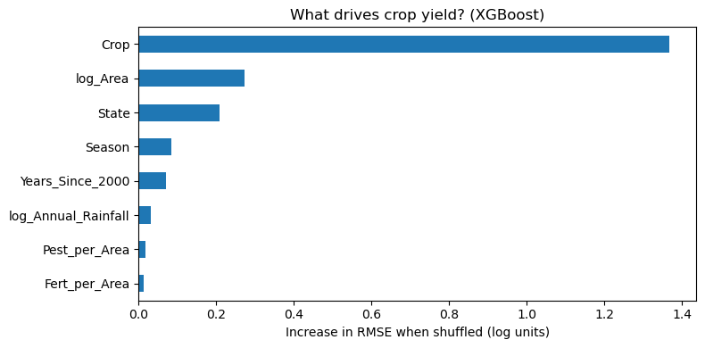
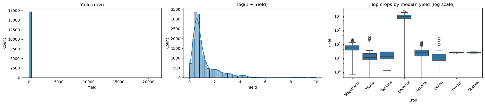
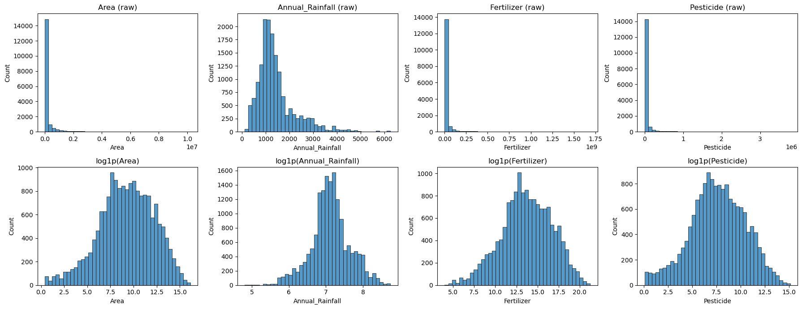
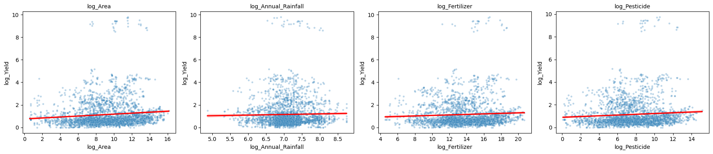
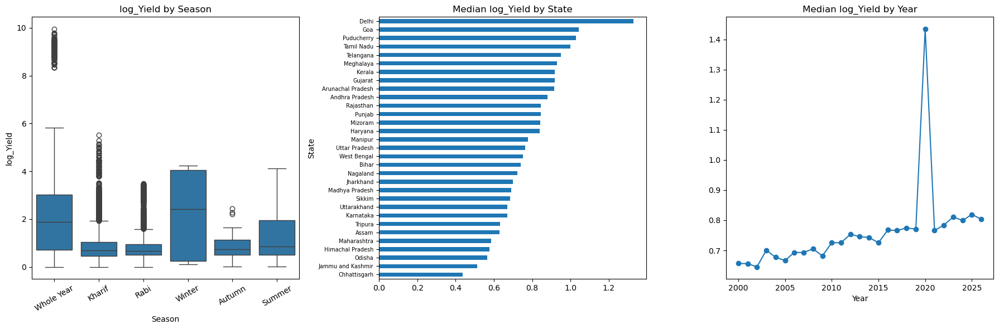
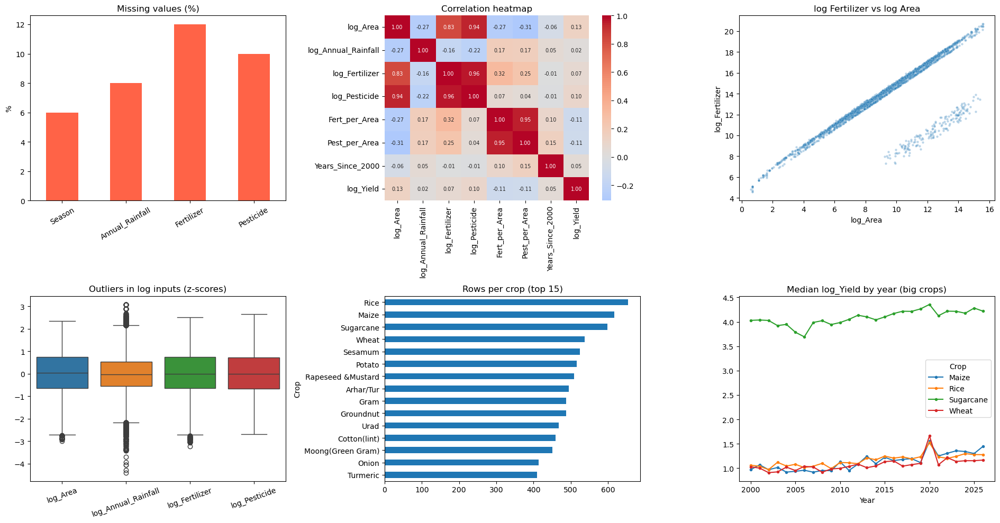
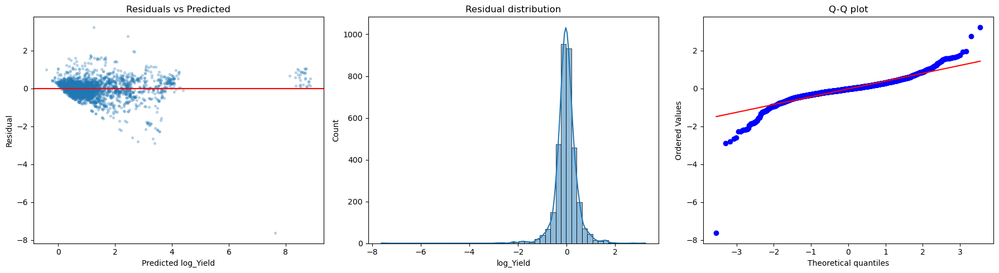

# 🌾 Indian Crop Yield Prediction

End-to-end machine learning regression project that predicts crop yield across Indian states from crop type, season, area, rainfall and input usage. It covers data auditing, leakage detection, log transformation, linear-model diagnostics, and a tuned XGBoost model.



**Final model:** XGBoost (depth 8), **test R² = 0.970** on log-yield (**0.966** in original units, **0.904** excluding Coconut), typical error about **13%** of a farm's yield. The linear baseline scored R² 0.864 on the same test set, and XGBoost cut its error by more than half.

---

## Table of contents
1. [Problem statement](#problem-statement)
2. [Dataset](#dataset)
3. [Project workflow](#project-workflow)
4. [Key findings](#key-findings)
5. [Model results](#model-results)
6. [What-if analysis and insights](#what-if-analysis-and-insights)
7. [Repository structure](#repository-structure)
8. [How to run](#how-to-run)
9. [Limitations](#limitations)
10. [Future work](#future-work)

---

## Problem statement

Crop yield (output per unit of land) varies widely by crop, state, season and year. Planners and agronomists need to know **which factors explain yield** and **how well it can be predicted** from information available before harvest.

**Goal:** build a regression model that predicts `Yield` from crop, state, season, year, area, rainfall, fertilizer and pesticide data, and use it to:
1. find the main drivers of yield,
2. compare a linear baseline with non-linear models,
3. test how sensitive predicted yield is to practical levers.

**Success criteria:** strong test R² with no leakage, honest handling of missing values and anomalies, and conclusions that are backed by diagnostics.

---

## Dataset

| Item | Detail |
|---|---|
| Source file | `india_crop_yield_train_missing.csv` |
| Size | 17,400 rows x 10 columns |
| Coverage | 31 states, 62 crops, 6 seasons, years 2000 to 2026 |
| Target | `Yield` (output per unit area; strongly right-skewed, median 1.10, max 21,105) |
| Inputs | `Year`, `State`, `Crop`, `Season`, `Area`, `Annual_Rainfall`, `Fertilizer`, `Pesticide` |
| Excluded | `Production` (data leakage, see below) |
| Missing values | `Fertilizer` 12%, `Pesticide` 10%, `Annual_Rainfall` 8%, `Season` 6%; no duplicate rows |

---

## Project workflow

`Load & audit` → `Leakage check` → `Target & input EDA` → `Log transforms` → `Feature engineering` → `Split & preprocessing` → `Baseline Linear Regression` → `Residual diagnostics & VIF` → `Label audit` → `Ridge / Lasso` → `Random Forest` → `XGBoost tuning` → `Feature importance` → `What-if analysis` → `Save pipeline`

**Key decisions**
- **Leakage:** `Yield` is almost exactly `Production ÷ Area` (correlation 0.9975, median ratio 1.000), so `Production` was dropped as an input.
- **Log transform:** the target and the inputs `Area`, `Rainfall`, `Fertilizer` and `Pesticide` were transformed with `log1p`, which cut skewness sharply (for example Area from 7.6 to -0.3).
- **Features:** per-hectare intensity features `Fert_per_Area` and `Pest_per_Area` (a subtraction in log space), and `Years_Since_2000`. Only independent pieces were used in the linear feature set to avoid perfect multicollinearity.
- **Missing values:** median / most-frequent imputation inside the pipeline. Blanks were random (6%, 8%, 10%, 12%) and unrelated to yield, so this is safe.
- **Coconut:** only 1% of rows, but it is recorded on a different scale (median about 9,100 versus 10 to 60 for most crops), so the model trains on `log1p(Yield)` and results are also reported without Coconut.

---

## Key findings

### 1. Yield is extremely skewed; a log transform fixes most of it
The raw histogram is one tall bar; log-yield is a recognisable hill.



### 2. Inputs are skewed too, and log makes them bell-shaped
Area, Fertilizer and Pesticide span millions of units; their log versions are close to symmetric.



### 3. No single numeric input explains yield
Correlations with log-yield are weak (largest is `log_Area` at 0.13), and the red trend lines are nearly flat. The small group of points near log-yield 9 is Coconut.



### 4. Crop explains most of the variance
Crop alone explains 83% of the variance in log-yield (η² = 0.83), against 20% for Season and 5% for State. Season partly reflects crop type, because long-duration crops are recorded as "Whole Year". Median yield also differs by state (Delhi highest, Chhattisgarh lowest), and the overall median rises slowly from about 0.65 to 0.8 (log units) between 2000 and 2026, with a one-year spike in 2020.



### 5. Missing values are random; fertilizer and pesticide scale with farm size
Missingness matches the 6/8/10/12% pattern and is unrelated to yield. Fertilizer is almost exactly `Area x constant`, with a small separate cluster of rows far below the line (likely anomalies). Yields drift upward slowly over time, with a visible spike in 2020.



### 6. The linear model fits well but has clear assumption problems
Residuals are centred (mean -0.018) but have very heavy tails (kurtosis about 30), driven by a few unusual rows. Breusch-Pagan and Jarque-Bera both reject; Durbin-Watson (2.00) passes. VIF is below 3.5 after re-parameterising the inputs.



### 7. What drives yield in the final model
Permutation importance (RMSE increase when a column is shuffled): **Crop 1.367**, `log_Area` 0.273, **State 0.209**, Season 0.084, Years 0.071, Rainfall 0.032. Fertilizer and pesticide per hectare are close to zero, because they barely vary across farms.


---

## Model results

| Model | Test R² (log) | Test RMSE (log) | Test MAE (log) | Test R² (original units, no Coconut) |
|---|---|---|---|---|
| Linear Regression | 0.864 | 0.445 | 0.288 | 0.694 |
| Ridge / Lasso | 0.864 | 0.445 | 0.288 | 0.694 / 0.691 |
| Random Forest | 0.967 | 0.219 | 0.123 | 0.889 |
| XGBoost (depth 6, first run) | 0.970 | 0.208 | 0.124 | 0.908 |
| **XGBoost (depth 8, final)** | **0.970** | **0.209** | **0.123** | **0.904** (0.966 all crops) |

**XGBoost tuning (selected on validation RMSE, not on test)**

| Setting | Val RMSE | Test RMSE |
|---|---|---|
| **Depth 8** | **0.233** | **0.209** |
| Depth 6 | 0.243 | 0.213 |
| Depth 4 | 0.252 | 0.222 |
| Regularised | 0.268 | 0.234 |

**Notes**
- Regularisation (Ridge/Lasso) changed nothing, because the linear model was not overfitting.
- The tree models win because they can learn crop-specific effects (for example, how area or rainfall acts differently for each crop).
- The final model has a train/test gap (RMSE 0.093 vs 0.209); the test score is still strong. Stronger regularisation made test scores worse.

---

## What-if analysis and insights

Average change in predicted yield when one input is changed for the 3,480 test rows (median shown):

| Scenario | Median change |
|---|---|
| 5 years later | +3.3% |
| Planted area +20% | +0.4% |
| Fertilizer per ha +20% | 0.0% |
| Rainfall +20% | 0.0% |
| Pesticide per ha +20% | 0.0% |
| Kharif → Rabi | -2.4% |

**Takeaways**
- **Crop and region choice dominate yield**; no input lever moves predictions much compared with the model's typical error (about 13%).
- A slow upward trend of roughly 0.7% to 0.8% per year exists.
- Fertilizer and pesticide effects **cannot be judged from this data**, because usage per hectare barely varies across farms.

---

## Repository structure

```
crop-yield-prediction/
├── data/
│   └── india_crop_yield_train_missing.csv
├── notebooks/
│   └── crop_yield_prediction.ipynb
├── images/                  # charts used in this README
├── models/
│   └── crop_yield_xgb.joblib
├── requirements.txt
└── README.md
```

---

## How to run

```bash
git clone https://github.com/<your-username>/crop-yield-prediction.git
cd crop-yield-prediction
pip install -r requirements.txt
jupyter notebook notebooks/crop_yield_prediction.ipynb
```

> Update the CSV path in the first notebook cell if your file is elsewhere.

**Use the saved model**
```python
import joblib, numpy as np
model = joblib.load("models/crop_yield_xgb.joblib")

# The model expects log-based features and predicts log(1 + Yield):
d["log_Area"] = np.log1p(d["Area"])
d["log_Annual_Rainfall"] = np.log1p(d["Annual_Rainfall"])
d["Fert_per_Area"] = np.log1p(d["Fertilizer"]) - d["log_Area"]
d["Pest_per_Area"] = np.log1p(d["Pesticide"]) - d["log_Area"]
d["Years_Since_2000"] = d["Year"] - 2000
cols = ["log_Area", "log_Annual_Rainfall", "Fert_per_Area", "Pest_per_Area",
        "Years_Since_2000", "Crop", "State", "Season"]
yield_pred = np.expm1(model.predict(d[cols]))
```

**requirements.txt**
```
pandas
numpy
matplotlib
seaborn
scikit-learn
scipy
statsmodels
xgboost
joblib
```

---

## Limitations
- `Yield` units differ across crops (for example Coconut), so original-unit metrics are dominated by a few crops; log-space scores are the main measure.
- A small number of rows have extreme or inconsistent yields (for example zero yield for crops that normally yield a lot). Even after checking `Yield` against `Production ÷ Area`, most of these rows were internally consistent, so they were kept.
- Some fertilizer values look anomalous relative to area (a small separate cluster).
- Feature importance and what-if results are **patterns in the data, not proven causes**.
- Fertilizer/pesticide per hectare vary very little, so their true effect cannot be estimated.
- The test set comes from a random split of the same file, so performance on new years or states may be lower.
- Data years go up to 2026, so the latest year may be incomplete.

## Future work
- Hold out the latest years (time-based split) to test forecasting.
- Investigate the low-fertilizer anomalies and the 2020 spike.
- Crop-specific models or crop x feature interactions for the linear model.
- SHAP explanations and cross-validated tuning.
- A Streamlit app on top of the saved pipeline.

---

## Author
**Your Name** · [LinkedIn](https://www.linkedin.com/in/nazmin-ansari-69357831a)
